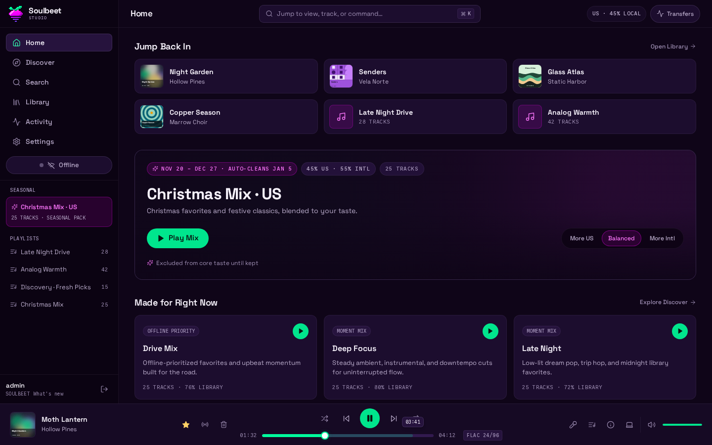
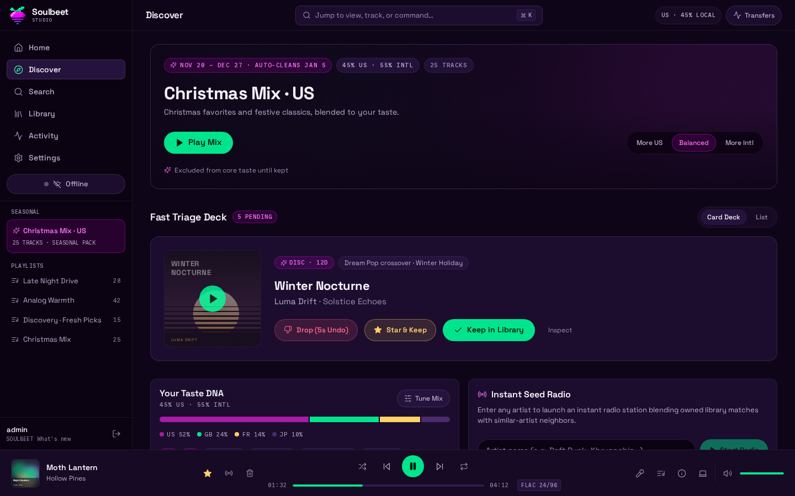

# Soulbeet

[](https://hub.docker.com/r/docccccc/soulbeet)
[](https://hub.docker.com/r/docccccc/soulbeet/tags)
[](https://hub.docker.com/r/docccccc/soulbeet/tags)

[](https://github.com/terry90/soulbeet/actions)
[](https://github.com/terry90/soulbeet)
[](https://github.com/terry90/soulbeet)

Soulbeet is an all-in-one self-hosted music player, downloader, library manager, and discovery studio backed by Navidrome. Play your library across the Web, Linux and Windows Desktop, Android, and Android Auto, acquire missing tracks in one tap, let beets tag and organize everything automatically, and discover new music tailored to your listening history. Or skip the UI and ask your AI assistant: Soulbeet is also an [MCP server](#mcp-server).

> "Make a Christmas playlist with 30 classics and download the ones I don't have."

## Screenshots

| Studio Home | Discovery 2.0 | Mobile |
| :---: | :---: | :---: |
|  |  |  |

Full screenshot gallery (home, discover, search, album, dashboard, downloads, settings, mobile): [screenshots](./screenshots)

## Features

- **Refined Midnight Studio Web Player**: Built-in audio player streaming directly from Navidrome, with synced karaoke lyrics, Precision Scrubber, command palette (`Ctrl+K`), keyboard shortcuts, Library Stats Bento with listening insights, and **Soulbeet Connect** cross-device playback handoff.
- **Native Clients (Desktop, Android & Android Auto)**: Offline-first Rust `client-core` (SQLite WAL mirror, FTS5 search, LRU FLAC and Opus 160 cache, mutation outbox) powering the **Linux & Windows Desktop app** (`libmpv` gapless playback, ReplayGain, MPRIS2/SMTC media keys, floating `360x110` Mini-Player) and the **Android + Android Auto app** (Jetpack Compose phone UI, 4-tab Android Auto media browser, local voice search, background offline sync). See [Clients](docs/clients.md).
- **Unified Multi-Backend Search & 1-Tap Acquire & Play**: Search your Navidrome library and MusicBrainz (tracks, albums, artist discographies) in one place. Tap any unowned track to **Acquire & Play** (fast acquisition with automatic playback handoff, plus background FLAC archival upgrade when you Keep it), auto-download full albums, or pick sources manually across all enabled download backends (**Soulseek**, **Internet Archive**, **YouTube Music**, **NetEase / GD Studio**, **Direct Connect / AirDC++**).
- **Discovery 2.0**: Personalized **Seasonal Packs** (with cultural Taste DNA and local/international steering isolated from your core taste), on-demand **Moment Mixes** (Drive, Morning, Focus, Late Night), **Triage Mode** (Keep / Drop with 5-second undo), **Seed Radio**, and rolling discovery profiles (Conservative, Balanced, Adventurous).
- **Multi-Listener Deletion Guard**: Safe deletion and curation on shared servers. Protects tracks starred, rated above 1 star, or kept in playlists by other household listeners, and shows a guard preview before any destructive action.
- **Ask your AI assistant**: Soulbeet is an MCP server. Connect Claude, ChatGPT, or any other MCP client and ask for an album or a whole playlist in plain words. It checks your library, downloads what is missing, and builds the playlist in Navidrome. See [MCP Server](#mcp-server).
- **Multi-user**: Private or shared folders. Each user gets their own discovery profiles, cultural profile, ListenBrainz username, and preferences.

## How It Works

You press play, search and download, or ask your assistant. Behind the scenes:

1. **Multi-backend acquisition**: Soulbeet searches across your enabled backends (Soulseek through **slskd** by default, plus optional Internet Archive, YouTube Music, NetEase / GD Studio, and Direct Connect / AirDC++), downloads the best source, tags and organizes it with **beets**, and puts it in your library.
2. **Navidrome streaming**: **Navidrome** scans the organized library and serves audio and artwork to the Web Studio Player and native clients. Set `NAVIDROME_PUBLIC_URL` when Navidrome runs behind a reverse proxy or container network so clients know the reachable address.
3. **Discovery 2.0**: Your **Navidrome** plays and stars (plus **ListenBrainz** history when configured, and optional Deezer artist radios) feed the recommendation engine. It builds rolling profiles, Seasonal Packs, Moment Mixes, and Seed Radio queues, downloads fresh candidates, reconciles Navidrome song IDs, and syncs smart playlists.
4. **Native clients**: The Desktop and Android apps embed `client-core`, which mirrors your library into local SQLite, caches FLAC or Opus 160 audio offline, queues offline ratings/scrobbles in an outbox, and syncs live playback state over Soulbeet Connect.

## MCP Server

Soulbeet is an MCP server, so any AI assistant that speaks MCP (Claude, ChatGPT, Cursor, your own agent...) can drive it. You ask for music in plain words, for example "Get In Rainbows by Radiohead into my library", "How is that batch of downloads going?" or "Do I have duplicates in my library?". The assistant checks your library, searches your enabled backends, downloads, imports and builds the Navidrome playlist, and you never open the web UI. Downloads keep running after you close the chat.

Serve Soulbeet over https at the root of a name (public, for hosted assistants such as claude.ai), then add `https://music.example.com/mcp` as a remote MCP server in your client and click **Allow** when Soulbeet asks. Clients sign in with OAuth, so there is no API key to copy around. Each person connects their own account, and the assistant acts as that person only. It cannot delete music until you allow it in Settings > Users > Connected apps.

[docs/mcp.md](docs/mcp.md) has the setup steps, the proxy examples (Caddy, nginx, Traefik, Cloudflare tunnel), every tool, the limits and the error codes.

## Getting Started with Docker

The recommended way to run Soulbeet is via Docker Compose. This ensures all dependencies (like `beets` and `python`) are correctly set up. The image supports both **AMD64** and **ARM64**.

### Prerequisites

- Docker & Docker Compose (or podman-compose)
- **slskd 0.26 or newer** (downloads are enqueued through the batches API introduced in 0.26). The compose file below runs one.

### Quick Start

1. Create a `docker-compose.yml` file:

```yaml
services:
  soulbeet:
    image: docker.io/docccccc/soulbeet:latest
    restart: unless-stopped
    ports:
      - 9765:9765
    environment:
      - DATABASE_URL=sqlite:/data/soulbeet.db
      - DOWNLOAD_PATH=/downloads
      # Optional, see step 2. Passed on only when it is set.
      - SECRET_KEY
      - NAVIDROME_URL=http://navidrome:4533
      # Optional: externally reachable Navidrome URL for browser & native clients
      # - NAVIDROME_PUBLIC_URL=https://music.example.com
      # Optional
      - BEETS_CONFIG=/config/config.yaml
    volumes:
      - ./data:/data
      - ./beets:/config
      - /path/to/slskd/downloads:/downloads
      - /path/to/music:/music
    depends_on:
      - slskd
      - navidrome

  navidrome:
    image: deluan/navidrome:latest
    ports:
      - "4533:4533"
    environment:
      - ND_MUSICFOLDER=/music
    volumes:
      - ./navidrome-data:/data
      - /path/to/music:/music

  slskd:
    image: slskd/slskd
    environment:
      - SLSKD_REMOTE_CONFIGURATION=true
    volumes:
      - ./slskd-config:/app/slskd.conf.d
      - /path/to/slskd/downloads:/app/downloads
    ports:
      - "5030:5030"
```

2. `SECRET_KEY` signs sessions and encrypts stored Navidrome passwords. It is optional: without it, Soulbeet generates a key on the first start and stores it in `secret.key` next to the database (in the `./data` volume above). Back up that file together with the database: losing or changing the key signs everyone out and makes the stored Navidrome passwords unreadable until each user enters theirs again. To set your own key instead, put a random value of at least 32 bytes in a `.env` file next to `docker-compose.yml` (a shorter key is not used, see [configuration](docs/configuration.md)). Skip this if your `.env` already sets `SECRET_KEY`; the command adds a line and keeps whatever the file already holds:

```bash
echo "SECRET_KEY=$(openssl rand -hex 32)" >> .env
```

3. Seed the beets config. `BEETS_CONFIG` replaces the config shipped in the image, so start from a copy of it. Use the same tag as the `image:` line above, since the shipped `plugins:` line depends on the tier (see [Image tiers](docs/beets.md#image-tiers)), and copy it again after you change tier:

```bash
TAG=latest # the tag on your image: line, such as latest, latest-medium or latest-full
mkdir -p beets
docker create --name sb "docker.io/docccccc/soulbeet:$TAG"
docker cp sb:/app/beets_config.yaml ./beets/config.yaml
docker rm sb
```

4. **Important**: The `/downloads` volume must match between `slskd` and `soulbeet` so Soulbeet can see the files `slskd` downloaded. The `/music` volume must match between `soulbeet` and `navidrome` so Navidrome can see the organized library.

5. Run:

```bash
docker-compose up -d
```

### Initial Setup

A fresh install has one account, `admin` with the password `admin`. It is the only admin. That password only signs in to choose a new one: until it is changed, the account can do nothing else. Everyone sees the Settings tabs, but only admins see user management in Settings > Users, the slskd and backend settings and Security Checks in Settings > Config, and the folder administration in Settings > Library.

1. Open `http://localhost:9765` and sign in as `admin` / `admin`, with or without Navidrome. Soulbeet asks for a new password before anything else; enter `admin` as the current password and choose yours.
2. In **Settings > Config**, connect slskd (URL + API key). [How to get an slskd API key](https://github.com/slskd/slskd/blob/master/docs/config.md#yaml-24). Optionally turn on additional download backends (Internet Archive, YouTube Music, NetEase / GD Studio, Direct Connect).
3. In **Settings > Library**, add your music folders (e.g. `/music`). Admins can add a folder anywhere.
4. Let the other users in:
   - **With Navidrome** (`NAVIDROME_URL` set): everyone signs in with their **Navidrome credentials**, and their Soulbeet account is created on the first sign-in. To make your own Navidrome account an admin, sign in with it once, then sign in as `admin` and click **Make admin** next to it in Settings > Users.
   - **Without Navidrome**: create the accounts in Settings > Users.
   - **With a login provider** such as Pocket ID or Authelia: see [single sign-on](docs/sso.md).
5. Users who are not admins can only add folders inside a folder root an admin approved. Add one under **Approved Folder Roots** in Settings > Library, for example `/music`, so a user can add `/music/alice`. The root itself cannot be the folder of a user who is not an admin. If one of your own folders is that root (an admin folder at `/music`), tick **Shared** next to it, or every folder inside it is refused as being inside another user's folder.
6. That's it. Play from your library, or search for any track and hit play or download.

For discovery (optional): enable discovery on a folder in Settings > Library, pick your profiles, and hit Generate. Play or star some music in Navidrome first, since that is what discovery starts from. You can also add your ListenBrainz username and cultural preferences there. [docs/discovery.md](docs/discovery.md) has the details.

**Upgrading** from a version without admin roles? Read [docs/upgrading.md](docs/upgrading.md) first: it signs everyone out and makes the seeded `admin` the only admin.

## Guides

- [Clients](docs/clients.md): the Web Studio Player (`NAVIDROME_PUBLIC_URL`, shortcuts, Soulbeet Connect), the Linux & Windows Desktop app, and the Android + Android Auto app.
- [Configuration](docs/configuration.md): environment variables and defaults (the `OIDC_*` ones are in Single sign-on), how sign-in works with Navidrome, and which settings live in the web UI.
- [Download backends](docs/download-backends.md): how Soulseek, Internet Archive, YouTube Music, NetEase (GD Studio), and Direct Connect plug in, unified search, and 1-tap Acquire & Play.
- [Internet Archive](docs/archive.md): archive.org search and download behavior, MD5 verification, and partial files.
- [YouTube Music](docs/ytdlp.md): yt-dlp / ytmusicapi Opus downloads in the `:full` image and lossy fallback rules.
- [NetEase (GD Studio)](docs/gdstudio.md): GD Studio API call budget, MD5 checks, and tagging behavior.
- [Direct Connect](docs/direct-connect.md): connecting an AirDC++ Web Client for DC hub search and TTH-verified downloads.
- [Discovery](docs/discovery.md): Discovery 2.0 (Seasonal Packs, Moment Mixes, Triage Mode, Seed Radio, On-Keep archival FLAC upgrades), rolling 6-hour playlists, and auto-delete.
- [Beets](docs/beets.md): the beets config file, import flags, skipped imports, image tiers, per-folder libraries, and album mode.
- [Beets plugins](docs/beets-plugins.md): the plugins each image tier ships, switching tiers, and adding your own plugins.
- [MCP server](docs/mcp.md): connecting an AI assistant, reverse proxy examples, every tool, the deletion checks, and the error codes.
- [Single sign-on](docs/sso.md): signing in through an OpenID Connect provider (Pocket ID, Authelia, Authentik, Keycloak), how accounts are matched, and when to turn off linking by name.
- [Health check](docs/health-check.md): the `/healthz` address for Docker and Kubernetes health checks, with a compose `healthcheck` and Kubernetes probes.
- [Upgrading](docs/upgrading.md): what changes on the first start after the release that adds admin roles and folder roots.
- [Development](docs/development.md): running Soulbeet (web, desktop, Android) from source, running tests, and refreshing the screenshots.

## Development

To run Soulbeet from source (server/web, desktop app, or Android app), run the tests, or refresh the screenshots, see [docs/development.md](docs/development.md).
