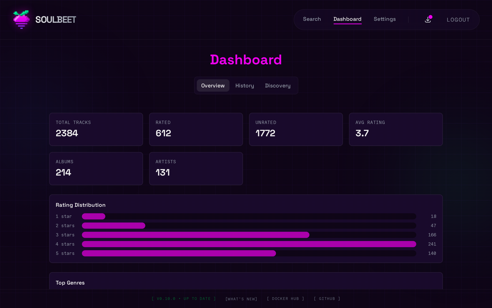
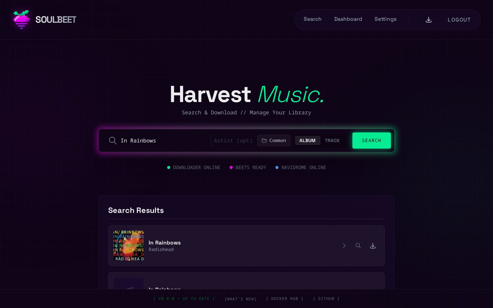
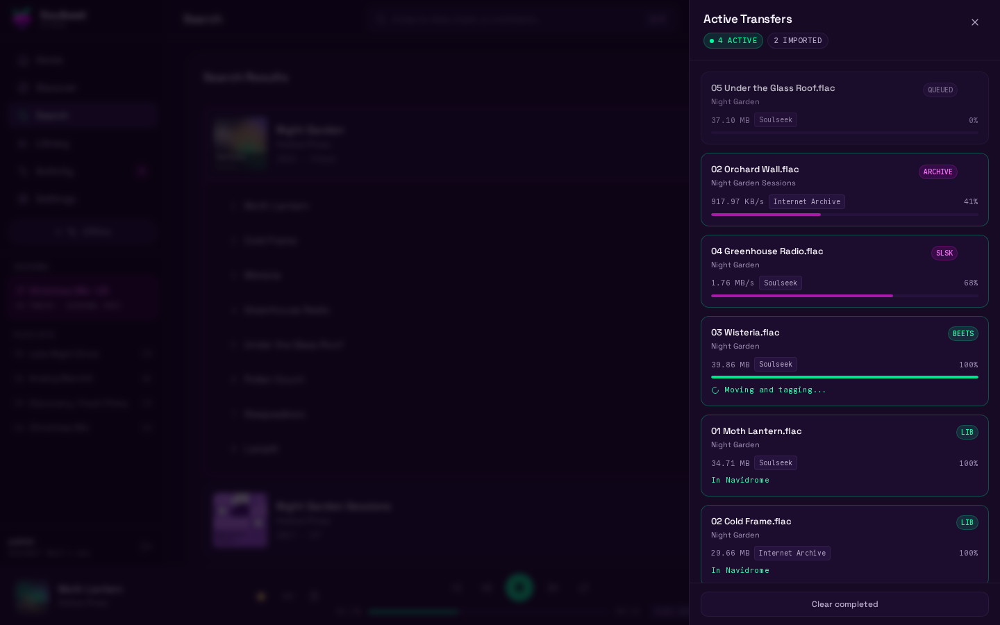
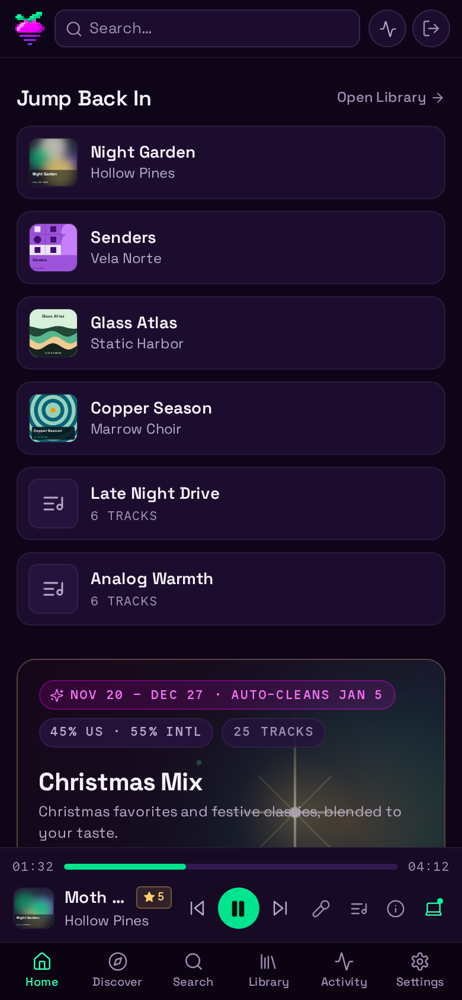

# Soulbeet

[](https://hub.docker.com/r/docccccc/soulbeet)
[](https://hub.docker.com/r/docccccc/soulbeet/tags)
[](https://hub.docker.com/r/docccccc/soulbeet/tags)

[](https://github.com/terry90/soulbeet/actions)
[](https://github.com/terry90/soulbeet)
[](https://github.com/terry90/soulbeet)

Soulbeet is a self-hosted music player, downloader, library organizer, and discovery studio powered by Navidrome and beets. Search for any track or album, acquire missing music in one tap across multiple sources, and listen on the web, desktop, Android, Android Auto, or through your AI assistant via MCP.

<p align="center">
  
</p>

## Quick Start (2 Minutes)
<a id="quick-start"></a>

Requires Docker and Docker Compose (AMD64 and ARM64 supported).

1. **Download `compose.yaml`**:
   ```bash
   curl -O https://raw.githubusercontent.com/terry90/soulbeet/master/compose.yaml
   ```
   Optional: point to an existing music folder with `MUSIC_DIR=/path/to/music` (or download [`.env.example`](.env.example) as `.env` to customize paths, ports, or image tags).

2. **Start the stack** (Soulbeet, Navidrome, and slskd pre-wired together):
   ```bash
   docker compose up -d
   ```

3. **Open `http://localhost:9765`**, sign in with `admin` / `admin`, and choose your new password. Your personal library folder (`/music/admin`) is created automatically, and no manual `SECRET_KEY` or `beets_config.yaml` setup is needed.

Want AcoustID fingerprinting (`:latest-medium`) or cover art, lyrics, ReplayGain, and YouTube Music (`:latest-full`)? Set `SOULBEET_TAG=latest-medium` or `SOULBEET_TAG=latest-full` in `.env`. See [Beets plugins](docs/beets-plugins.md) for tier details.

## Bringing an Existing Music Library?

Already have MP3s or FLACs on disk? You can import them into Soulbeet in one click:

1. Place your files in your personal folder (`/music/<username>`) or make sure your existing folder is mounted under `/music`.
2. Open **Settings > Library** (or click the import banner on the **Home** page) and select **Import Existing Library**.
3. Pick an import mode:
   - **Tag & Organize** (recommended): matches tracks with MusicBrainz, writes clean tags, and organizes files neatly into your library folder.
   - **Tag In-Place**: updates tags without moving or renaming your existing files.
   - **Register As-Is**: registers your files in Soulbeet's beets database using their current tags without modifying them.
4. Any albums beets is unsure about show up in the **Match Picker** on the **Activity** page so you can pick the right release or import them as-is. Skipping or cancelling never deletes your files.

## Screenshots

| Discovery 2.0 & Fast Triage | Library Stats Bento |
| :---: | :---: |
|  |  |

| Unified Multi-Backend Search | Active Transfers |
| :---: | :---: |
|  |  |

<p align="center">
  
</p>

More screenshots (`home`, `discover`, `search`, `album`, `dashboard`, `downloads`, `settings`, `mobile`): [screenshots](./screenshots)

## Core Features

- **Web Studio Player & Native Clients**: Stream directly from Navidrome with synced karaoke lyrics, keyboard shortcuts, command palette (`Ctrl+K`), Library Stats Bento, and **Soulbeet Connect** playback handoff across the Web UI, Linux/Windows Desktop app, Android, and Android Auto (offline SQLite mirror, FLAC/Opus cache, background sync). See [Clients](docs/clients.md).
- **1-Tap Acquire & Play across Multiple Backends**: Search your library and MusicBrainz in one place, then tap any unowned track to acquire and start playing automatically. Supports **Soulseek** (via slskd) plus optional **Internet Archive**, **YouTube Music**, **NetEase (GD Studio)**, and **Direct Connect (AirDC++)**. See [Download Backends](docs/download-backends.md).
- **Discovery 2.0**: Personalized **Seasonal Packs**, on-demand **Moment Mixes** (Drive, Morning, Focus, Late Night), fast **Triage Mode** (Keep / Drop with undo), **Seed Radio**, and rolling discovery profiles powered by your Navidrome and ListenBrainz listening history. See [Discovery](docs/discovery.md).
- **1-Click Household Track & Album Sharing**: Each user gets a personal library folder (`/music/<username>`) and dedicated Navidrome library. Share any track or full album with household members in one click using filesystem hardlinks: zero extra disk space, independent libraries, and independent 1-star deletion (deleting a shared track only removes your copy, never anyone else's).
- **AI Assistant Ready (MCP Server)**: Connect Claude, ChatGPT, Cursor, or any MCP client over OAuth (`https://your-domain/mcp`) and ask for albums, playlists, or library audits in plain English. See [MCP Server](docs/mcp.md).

## Documentation

| Category | Guide | What it covers |
| :--- | :--- | :--- |
| **Setup & Ops** | [Configuration](docs/configuration.md) | Environment variables, `compose.yaml` defaults, single-folder libraries, and web UI settings |
| **Setup & Ops** | [Health Check](docs/health-check.md) | `/healthz` endpoint for Docker Compose and Kubernetes probes |
| **Setup & Ops** | [Single Sign-On](docs/sso.md) | OpenID Connect login with Pocket ID, Authelia, Authentik, or Keycloak |
| **Setup & Ops** | [Upgrading](docs/upgrading.md) | Upgrade notes, legacy folder migration, and breaking changes |
| **Listening** | [Clients](docs/clients.md) | Web Studio Player, Soulbeet Connect, Desktop app, and Android / Android Auto |
| **Listening** | [Discovery](docs/discovery.md) | Discovery 2.0, Seasonal Packs, Moment Mixes, Triage Mode, and auto-delete |
| **Tagging** | [Beets](docs/beets.md) | Existing library import, import flags, skipped matches, album mode, and library databases |
| **Tagging** | [Beets Plugins](docs/beets-plugins.md) | Image tiers (`:latest`, `:latest-medium`, `:latest-full`) and custom drop-in plugins |
| **Sources** | [Download Backends](docs/download-backends.md) | Unified search, multi-backend acquisition, and 1-tap Acquire & Play |
| **Sources** | [Internet Archive](docs/archive.md) | Archive.org search, downloads, and MD5 verification |
| **Sources** | [YouTube Music](docs/ytdlp.md) | yt-dlp / ytmusicapi Opus downloads in the `:latest-full` image |
| **Sources** | [NetEase (GD Studio)](docs/gdstudio.md) | GD Studio API budget, MD5 checks, and tagging behavior |
| **Sources** | [Direct Connect](docs/direct-connect.md) | Connecting an AirDC++ Web Client for DC hubs and TTH verification |
| **AI & Dev** | [MCP Server](docs/mcp.md) | OAuth setup, reverse proxy configs, available tools, and safety guards |
| **AI & Dev** | [Development](docs/development.md) | Building from source (`docker-compose.dev.yml`), tests, desktop/Android builds, and screenshots |
